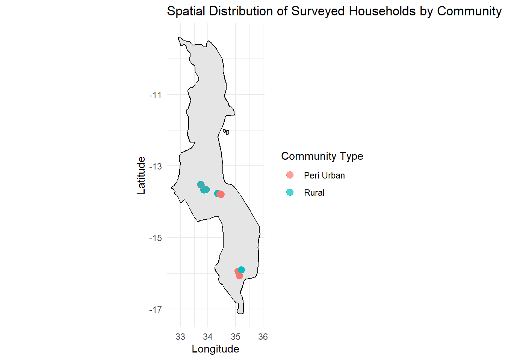
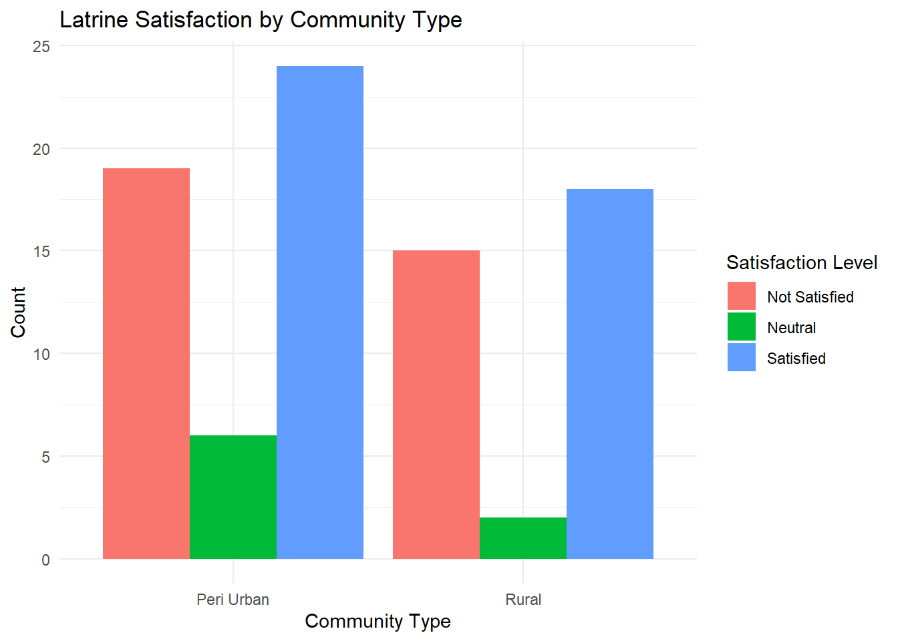

# Household Latrine User Survey – Dowa & Thyolo Malawi (2020)

[](https://doi.org/10.5281/zenodo.17512718)

This dataset was collected in October 2020 from Dowa and Thyolo
Districts, Malawi, using the mWater survey platform. It captures
detailed information on household sanitation practices and latrine usage
across both rural and peri-urban communities. The survey was conducted
by trained enumerators working with BASEflow Malawi as part of efforts
to document and improve Water, Sanitation, and Hygiene (WASH)
infrastructure and behavior in the region.

**Potential Use Cases**

This data is a valuable resource for multiple stakeholders, including:

1.  Local Government & Planners: To inform sanitation infrastructure
    planning and budgeting in rural and peri-urban Malawi.

2.  Public Health Practitioners: To study the relationship between
    latrine use and hygiene-related health outcomes.

3.  WASH Sector NGOs: To identify service delivery gaps, monitor impact,
    or design targeted behavior change programs.

4.  Researchers & Academics: For sanitation behavior studies,
    infrastructure sustainability, and social acceptability of different
    latrine models.

5.  Donors & Development Partners: To assess community sanitation needs,
    target investments, and support SDG 6 (Clean Water and Sanitation).

## Installation

You can install the development version of dowalatrinesurvey from
[GitHub](https://github.com/) with:

``` r

# install.packages("devtools")
devtools::install_github("openwashdata/dowalatrinesurvey")
```

``` r

## Run the following code in console if you dont have the packages
## install.packages(c("dplyr", "knitr", "readr", "stringr", "gt", "kableExtra"))
library(dplyr)
library(knitr)
library(readr)
library(stringr)
library(gt)
library(kableExtra)
```

Alternatively, you can download the individual datasets as a CSV or XLSX
file from the table below.

1.  Click Download CSV. A window opens that displays the CSV in your
    browser.
2.  Right-click anywhere inside the window and select “Save Page As…”.
3.  Save the file in a folder of your choice.

| dataset | CSV | XLSX |
|:---|:---|:---|
| dowalatrinesurvey | [Download CSV](https://github.com/openwashdata/dowalatrinesurvey/raw/main/inst/extdata/dowalatrinesurvey.csv) | [Download XLSX](https://github.com/openwashdata/dowalatrinesurvey/raw/main/inst/extdata/dowalatrinesurvey.xlsx) |

## Data

The package provides access to Latrine Household Data for Dowa and
Thyolo Districts in Malawi for the year 2020.

``` r

library(dowalatrinesurvey)
```

### dowalatrinesurvey

The dataset `dowalatrinesurvey` contains 89 observations and 80
variables

``` r

dowalatrinesurvey |> 
  head(3) |> 
  gt::gt() |>
  gt::as_raw_html()
```

| submitted_on | community_type | latitude | longitude | traditional_authority | district | familiar_sanitation_types | latrines_in_community | sanitation_system_home | photo_sanitation_facility | sanitation_location_to_home | purchase_installation_process | latrine_installed | system_duration_magnitude | system_duration_unit | latrine_builder | facility_in_use | is_pit_lined | pit_lining_material | other_waste_disposed | other_waste_specified | biogas_generation | toilet_build_cost | cost_affordability | reasonable_cost_magnitude | reasonable_cost_unit | install_duration_magnitude | install_duration_unit | latrine_usage_process | safe_for_vulnerable | adapted_for_disabled | men_use_for_urination | liked_features | liked_features_other | sit_or_squat | currently_do | used_at_night | has_light | bring_own_light | bring_own_light_comments | odor_control | has_vent_pipe | prefer_less_odor | satisfaction_with_latrine | issues_with_animals | animal_issues_other | ideal_latrine_description | latrine_within_30m_water | latrine_distance_to_water | water_source | flush_with_water | latrine_description | soil_description | soil_description_other | latrine_user_count | latrine_built_year | expected_lifespan_magnitude | expected_lifespan_unit | privacy_enclosure_other_uses | above_ground_maintenance | above_ground_maintenance_other | above_ground_cleaning | uses_cleaning_chemicals | maintenance_frequency | maintenance_by | maintenance_by_other | maintenance_cost | cleaning_major_issue | pit_latrine_condition | is_filled_up | is_replacement | previous_filled_count | fill_up_speed | is_abandoned | reason_for_abandonment | is_emptied | why_not_emptied | why_not_emptied_other | emptying_frequency | emptying_method |
|---:|:---|---:|---:|:---|:---|:---|:---|:---|:---|:---|:---|:---|---:|:---|:---|:---|:---|:---|:---|:---|:---|:---|:---|---:|:---|---:|:---|:---|:---|:---|:---|:---|:---|:---|:---|:---|:---|:---|:---|:---|:---|:---|:---|:---|:---|:---|:---|---:|:---|:---|:---|:---|:---|:---|---:|---:|:---|:---|:---|:---|:---|:---|:---|:---|:---|:---|:---|:---|:---|:---|---:|:---|:---|:---|:---|:---|:---|:---|:---|
| 10/14/2020 | Rural | -13.51292 | 33.74087 | TA Dzoole | Dowa | Pit Latrine with Slab | No | NA | <https://api.mwater.co/v3/images/4fcff19b60fd4e4fb8e8e8fcf365d456> | Between 10 meters to 15 meters | I bought bricks for lining and enclosure, cement was donation but i ls bought iron sheets. It took a month building this latrine from the pit up | NA | NA | NA | NA | Yes | Yes | Bricks | Other | Nothing | Not Applicable | NA | Easy | 30000 | MK | 1 | Months | I get wiping materials like paper which is very rare but leaves are commonly used, then i go in to relief myself then off i go | Very safe | No | No | Concrete Slab | NA | Seat | Squatting | Yes | No | Yes | We usually use torch light | No | No | Yes | 3 (satisfied) | Other | We were once infested by cockroaches from the latrine | I would prefer a VIP latrine with vent nd toilet seat for easy flushing | No | NA | Borehole or tubewell | No | Our latrine is 6metre deep, lined with bricks then covered with a san plat,. It has an enclosure of bricks nd a roof of iron sheets | Dry | NA | 11 to 20 people | 6/8/2017 | 15 | Years | No | Wall maintenance | NA | Mopping | Water only | None | Owner of the house, Other | Particularly wife for cleaning | No cost | No | Structurally stable | No | Yes | 2 | More than 3 years | Abandoned | It has filled up | No | Other | The design of latrines we have here do not have qualities that can allow us to empty | NA | NA |
| 10/14/2020 | Peri Urban | -13.51868 | 33.74178 | TA Dzoole | Dowa | Pit Latrine with Slab | No | NA | <https://api.mwater.co/v3/images/c7d1d8acfeec4111bdaa4c093646cf25> | Less than 10 meters | They are tenants in the house so they found the latrine built already | NA | NA | NA | NA | Yes | Yes | Cement Concrete | Ashes | NA | No | NA | Easy | 50000 | MK | 3 | Weeks | Before i go i make sure there is water close by, then they make sure tissue is available and then they go in, after that they wipe and wash their hands | Very safe | No | Yes | Handwashing Point, Toilet Seat | NA | Seat | Squatting | Yes | No | Yes | Candle is used | No | No | Yes | 1 (not satisfied) | Yes | NA | Pour flush toilet, with a sit and a sink inside | Yes | 20 | Piped into yard/plot | No | Pit latrine with a slab and iron sheets. When you go in you fimd a hole in the middle of the toilet and you squat to use it. Ghe latrine is next to the bathroom, so thwt water can seeve through the toilet from the bathroom to minimize odor | Dry | NA | 6 to 10 people | 6/1/2016 | 6 | Years | No | Roof maintenance, Door maintenance, Floor maintenance, Wall maintenance | NA | Sweeping, Mopping | Water only | Daily | Owner of the house | NA | MK 5,000 - 10,000 | No | Structurally stable | No | No | NA | NA | Not Applicable | NA | Not Applicable | NA | NA | NA | NA |
| 10/14/2020 | Rural | -13.51877 | 33.74200 | TA Dzoole | Dowa | Flush/Pour flush toilet, Pit Latrine with Slab, Pit Latrine without slab/Open pit | NA | NA | <https://api.mwater.co/v3/images/72d08ce10e614e35a704719e31eb8d88> | Between 10 meters to 15 meters | Dug a hole Bought bricks Bricks are laid as floor and smeared Then the wall is erected And logs and grass for the roof | NA | NA | NA | NA | Yes | No | NA | Other | Hot water | No | NA | Difficult | 15000 | MK | 1 | Weeks | From the house we use any type of papers around We use a bucket for washing hands that is placed closed to the latrine | Very safe | No | Yes | Concrete Slab | NA | Squat | Squatting | Yes | No | NA | We use matches or phone flashlight | Yes | No | Yes | 1 (not satisfied) | Yes | NA | It could use burnt bricks Plastered Cemented floor Iron sheet roof | No | NA | Surface Water, Piped into dwelling | No | It was built using moulded bricks and soil Grass roof | Dry | NA | 6 to 10 people | 1/1/2016 | 4 | Years | No | Other | No maintenance done | Sweeping, Smearing | Water only | Monthly | Owner of the house | NA | No cost | Yes | Structurally stable | No | Yes | 3 | 2-3 years | Abandoned | Replaced by new sanitation facility | No | Other | Its a worthless building it shouldnt be given too much attention like that | NA | NA |

For an overview of the variable names, see the following table.

| variable_name | variable_type | description |
|:---|:---|:---|
| submitted_on | character | The date and time when the survey form was submitted. |
| community_type | character | The classification of the community (e.g., rural, urban, periurban). |
| latitude | numeric | The latitude coordinate of the sanitation facility location. |
| longitude | numeric | The longitude coordinate of the sanitation facility location. |
| traditional_authority | character | The name of the traditional authority governing the survey area. |
| district | character | The district in which the survey was conducted. |
| familiar_sanitation_types | character | Types of latrines, toilets, or sanitation systems the respondent is familiar with. |
| latrines_in_community | character | Whether there are latrine systems present in the respondents community. |
| sanitation_system_home | character | The specific type of sanitation system used at the respondents home or facility. |
| photo_sanitation_facility | character | A photo taken of the sanitation facility. |
| sanitation_location_to_home | character | The physical location of the sanitation facility in relation to the house (e.g., within compound, nearby). |
| purchase_installation_process | character | Description of how the latrine was purchased and installed. |
| latrine_installed | character | Whether the respondent or household installed any latrine system. |
| system_duration_magnitude | numeric | The numerical duration indicating how long the current latrine system has been in use. |
| system_duration_unit | character | The unit of time (e.g., years, months) for how long the system has been used. |
| latrine_builder | character | The person(s) or organization that helped build the toilet. |
| facility_in_use | character | Indicates whether the latrine facility is currently being used. |
| is_pit_lined | character | Whether the latrine pit is lined for structural stability. |
| pit_lining_material | character | The material used to line the pit (e.g., bricks, concrete). |
| other_waste_disposed | character | Additional nonhuman waste disposed of in the latrine. |
| other_waste_specified | character | Details or specification of the other types of waste disposed. |
| biogas_generation | character | Whether the sanitation system generates biogas. |
| toilet_build_cost | character | Reported cost of constructing the toilet. |
| cost_affordability | character | Perception of how affordable it was to construct the toilet. |
| reasonable_cost_magnitude | numeric | Estimated amount considered reasonable for building a latrine. |
| reasonable_cost_unit | character | Unit of the reasonable cost (e.g., MWK, USD). |
| install_duration_magnitude | numeric | Time taken to construct the toilet (numeric value). |
| install_duration_unit | character | Unit for time taken (e.g., days, weeks). |
| latrine_usage_process | character | Stepbystep user explanation of how the latrine is used. |
| safe_for_vulnerable | character | Whether the latrine is considered safe for children, elderly, and persons with disabilities. |
| adapted_for_disabled | character | Whether the latrine is physically adapted for disabled users (based on observation). |
| men_use_for_urination | character | If men in the community consistently use latrines for urination. |
| liked_features | character | Features of the latrine that users appreciate. |
| liked_features_other | character | Additional specific features liked, as specified by respondent. |
| sit_or_squat | character | Preferred toilet posture (sitting or squatting). |
| currently_do | character | Actual practice (sitting or squatting) during use. |
| used_at_night | character | Whether the latrine is used during nighttime hours. |
| has_light | character | If there is a light source inside the latrine. |
| bring_own_light | character | Whether users bring their own light when using the latrine at night. |
| bring_own_light_comments | character | Comments or descriptions of the type of light used or brought. |
| odor_control | character | Whether controlling odor in the latrine is a concern. |
| has_vent_pipe | character | Indicates if the latrine has a ventilation pipe. |
| prefer_less_odor | character | Whether the respondent would prefer a latrine with less odor. |
| satisfaction_with_latrine | character | Respondents overall satisfaction with their current latrine. |
| issues_with_animals | character | Whether the latrine has experienced issues with rodents or burrowing animals. |
| animal_issues_other | character | Additional details about animalrelated issues. |
| ideal_latrine_description | character | Description of a respondents ideal latrine setup. |
| latrine_within_30m_water | character | Whether a latrine is located within 30 meters of a drinking water source. |
| latrine_distance_to_water | numeric | Measured distance from the latrine to the nearest water source (in meters). |
| water_source | character | The main source of water for the household. |
| flush_with_water | character | Whether water is used to flush the latrine. |
| latrine_description | character | Narrative description of the latrine owned or used. |
| soil_description | character | Type and condition of soil around the latrine. |
| soil_description_other | character | Further details about the soil condition if not covered in options. |
| latrine_user_count | character | Number of people who use the latrine. |
| latrine_built_year | character | Year in which the latrine was built. |
| expected_lifespan_magnitude | numeric | How long the latrine is expected to last (numeric). |
| expected_lifespan_unit | character | Unit of expected lifespan (e.g., years, months). |
| privacy_enclosure_other_uses | character | Whether the latrine privacy area is used for other activities (e.g., bathing, changing clothes). |
| above_ground_maintenance | character | Types of maintenance done on the aboveground structure of the latrine. |
| above_ground_maintenance_other | character | Additional details on maintenance tasks not listed. |
| above_ground_cleaning | character | Cleaning practices used for the aboveground part of the latrine. |
| uses_cleaning_chemicals | character | Whether any chemicals are used for cleaning. |
| maintenance_frequency | character | How often the latrine is maintained or cleaned. |
| maintenance_by | character | Who is responsible for maintenance and cleaning of the latrine. |
| maintenance_by_other | character | Other persons or roles responsible, if not listed. |
| maintenance_cost | character | Estimated cost spent on maintaining and cleaning the latrine. |
| cleaning_major_issue | character | Whether cleaning the latrine is a major concern for the user. |
| pit_latrine_condition | character | Current physical condition of the pit latrine. |
| is_filled_up | character | Whether the latrine pit is currently filled up. |
| is_replacement | character | If the current latrine is a replacement for a previously filled one. |
| previous_filled_count | numeric | Number of pit latrines that filled up before this one. |
| fill_up_speed | character | How quickly the previous latrine filled up. |
| is_abandoned | character | Whether the latrine is abandoned or potentially reusable. |
| reason_for_abandonment | character | Reason why the latrine was abandoned. |
| is_emptied | character | Whether the latrine has ever been emptied. |
| why_not_emptied | character | Reason why the latrine hasnt been emptied. |
| why_not_emptied_other | character | Additional specification on why the latrine hasnt been emptied. |
| emptying_frequency | character | How often the latrine is emptied (if applicable). |
| emptying_method | character | The method used for emptying the pit latrine. |

## Visualizations

``` r

library(dowalatrinesurvey)

# Visualization 1 Spatial Distribution Map by Community Type
# Purpose is to show how households with different community_type (Rural vs Peri-Urban) are spatially distributed across your study area.

library(dplyr)
library(ggplot2)
library(maps)
library(stringr)
# Clean community_type in dowalatrinesurvey
dowalatrinesurvey <- dowalatrinesurvey %>% mutate(community_type = trimws(community_type))

# Get Malawi map data from maps package
malawi_map <- map_data("world", region = "Malawi")

# Plot using dowalatrinesurvey
ggplot() +
  geom_polygon(
    data = malawi_map,
    aes(x = long, y = lat, group = group),
    fill = "gray90",
    color = "black"
  ) +
  geom_point(
    data = dowalatrinesurvey,
    aes(x = longitude, y = latitude, color = community_type),
    size = 3, alpha = 0.7
  ) +
  coord_fixed(1.3) +  # fix aspect ratio for lat/lon
  labs(
    title = "Spatial Distribution of Surveyed Households by Community Type",
    x = "Longitude",
    y = "Latitude",
    color = "Community Type"
  ) +
  theme_minimal()
```



``` r


# Visualization 2: Grouped bar chart showing count of latrine satisfaction by community type
# visually compare the levels of satisfaction with latrines between different types of communities
# (e.g., Rural vs Peri-Urban)

# Clean and factor satisfaction variable
data <- dowalatrinesurvey %>%
  mutate(
    satisfaction_clean = str_extract(satisfaction_with_latrine, "^[0-9]"),
    satisfaction_clean = factor(satisfaction_clean, levels = c("1", "2", "3"),
                                labels = c("Not Satisfied", "Neutral", "Satisfied"))
  ) %>%
  filter(!is.na(satisfaction_clean))  # Remove NA

# Summarize counts
satisfaction_summary <- data %>%
  group_by(community_type, satisfaction_clean) %>%
  summarise(count = n(), .groups = "drop")

# Plot grouped bar chart (counts)
ggplot(satisfaction_summary, aes(x = community_type, y = count, fill = satisfaction_clean)) +
  geom_bar(stat = "identity", position = "dodge") +  # side-by-side bars
  labs(
    title = "Latrine Satisfaction by Community Type",
    x = "Community Type",
    y = "Count",
    fill = "Satisfaction Level"
  ) +
  theme_minimal()
```



## License

Data are available as
[CC-BY](https://github.com/openwashdata/%7B%7B%7Bpackagename%7D%7D%7D/blob/main/LICENSE.md).

## Citation

Please cite this package using:

``` r

citation("dowalatrinesurvey")
#> To cite package 'dowalatrinesurvey' in publications use:
#> 
#>   Mhango E (2025). "dowalatrinesurvey: Household Latrine Survey Data
#>   from Dowa and Thyolo, Malawi."
#>   <https://github.com/openwashdata/dowalatrinesurvey>.
#> 
#> A BibTeX entry for LaTeX users is
#> 
#>   @Misc{mhango:2025,
#>     title = {dowalatrinesurvey: Household Latrine Survey Data from Dowa and Thyolo, Malawi},
#>     author = {Emmanuel Mhango},
#>     year = {2025},
#>     url = {https://github.com/openwashdata/dowalatrinesurvey},
#>     abstract = {Contains survey data collected in October 2020 from households in Dowa and Thyolo Districts, Malawi. The dataset includes detailed information on household sanitation practices, latrine infrastructure, usage patterns, maintenance behaviors, and user preferences across rural and peri-urban communities. Data was collected using the mWater survey platform by BASEflow Malawi enumerators.},
#>     version = {0.0.0.9000},
#>   }
```
